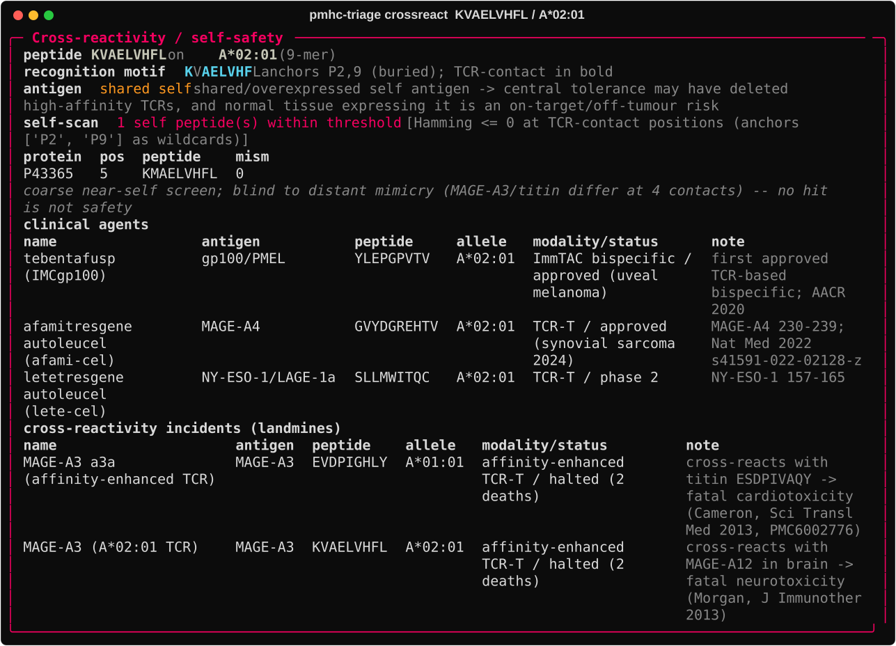

# pmhc-triage

[](https://github.com/ssiddhantsharma/pmhc-triage/actions/workflows/ci.yml)
[](LICENSE)

**HLA-coverage-adjusted estimates of how many patients a pMHC / T-cell immunotherapy target can actually reach.**

## Why

Target-prioritization tools (Open Targets, etc.) are HLA-blind. But a pMHC-directed therapy (a TCR-T, a TCR-mimic antibody, a bispecific) only works if the patient's HLA can present the target peptide: a binder against *peptide-X on HLA-A\*02:01* is useless in an A\*02:01-negative patient. So **raw disease incidence overstates who a pMHC target can reach**, by an amount that varies wildly across populations (A\*02:01 is common in Europe, A\*11:01 in East Asia).

`pmhc-triage` corrects for this:

```
effective addressable N = disease incidence
                        × antigen-positive fraction
                        × HLA population coverage (of the alleles presenting the peptide)
```

Every value carries its source, URL, query date, and method: sourced and reproducible, not invented.

## Install

```bash
pip install -e ".[dev]"                 # core + tests
pip install -e ".[presentation]"        # optional: MHCflurry allele prediction
```

## Quickstart

```bash
# 1) fetch allele frequencies from AFND (license-clean, on your machine)
pmhc-triage fetch-freqs --out freqs.tsv

# 2) score a target, incidence auto-filled from the shipped cited bundle
pmhc-triage score --gene KRAS --variant G12D --disease "pancreatic cancer" \
  --study paad_tcga_pan_can_atlas_2018 --alleles "A*03:01,A*11:01" \
  --populations Europe,EastAsia,SouthAsia --freqs freqs.tsv
```

Output: a `rich` table of per-population effective-N, a Monte-Carlo 95% interval, and a provenance record for every factor. Add `--rank` to sort targets/populations by effective addressable-N. Other commands: `discover` (disease to candidate targets), `run` (batch YAML), `validate` (fail-fast preflight).

## Cross-reactivity / safety axis

Addressable-N tells you *how many* patients; it says nothing about whether the epitope is *safe* to target. `crossreact` adds that axis for a chosen epitope: the recognition motif (TCR-contact positions, anchors treated as wildcards; A\*01:01 anchors at P3, not the class-I default P2), a neoantigen-vs-shared-self flag, curated clinical agents, and the landmark cross-reactivity incidents.

```bash
pmhc-triage crossreact --peptide EVDPIGHLY --allele "A*01:01" --antigen MAGE-A3
# opt-in proteome self-scan (off by default so the base run stays fast):
pmhc-triage crossreact --peptide KVAELVHFL --allele "A*02:01" --proteome UP000005640.fasta
```



The self-scan (`--proteome`, any UniProt FASTA) flags self peptides matching the target at its TCR-contact positions. It catches **close** mimics (MAGE-A12 vs MAGE-A3 differ only at the P2 anchor, so the contact face is identical and flags at zero mismatch) but is **blind** to distant structural mimicry (the fatal MAGE-A3 / cardiac-titin pair differs at 4 contact positions, past any sane Hamming threshold). **Absence of a hit is not a safety guarantee**: the curated incident list ships and experimental screening stays mandatory.

## Design principles

- **Provenance-first**: every number carries its source; a missing input is surfaced (`None` + reason), never silently zeroed.
- **Join guard**: incidence × coverage combine only within the *same* population label, never across.
- **Uncertainty visible**: factors carry sample size + CI; `effective_N` carries a seeded Monte-Carlo interval.
- **Never bundle licensed data**: AFND (CC BY-NC) is fetched on your machine, not redistributed.

## Does the number hold up?

See [`validation/`](validation/) for the evidence. The tool recovers known KRAS G12D restriction (A\*03:01/A\*11:01) from sequence; HLA-adjustment reorders targets across restriction families but is a flat multiplier within a shared HLA superfamily; the multiplicative model's independence bias is bounded from Marty et al. 2017. It is **not** validated against a ground-truth addressable population, so treat outputs as *sourced, reproducible estimates*, not measured truth.

A subset is committed as **reproducible live tests** asserting agreement with known biology (KRAS G12D fraction ~0.27, UniProt residue 12 = G, MHCflurry recovering A\*03:01/A\*11:01). They hit external services, so they run only on request:

```bash
pytest         # hermetic unit tests (mocked APIs); what CI runs
pytest -m live # live checks vs known biology (self-skip if a service is down)
```

## Data & license

Code: **Apache-2.0**. Data attribution and terms in [`NOTICE`](NOTICE) (GCO/GLOBOCAN incidence, cBioPortal ODbL, AFND CC BY-NC, UniProt, Open Targets, MHCflurry).
